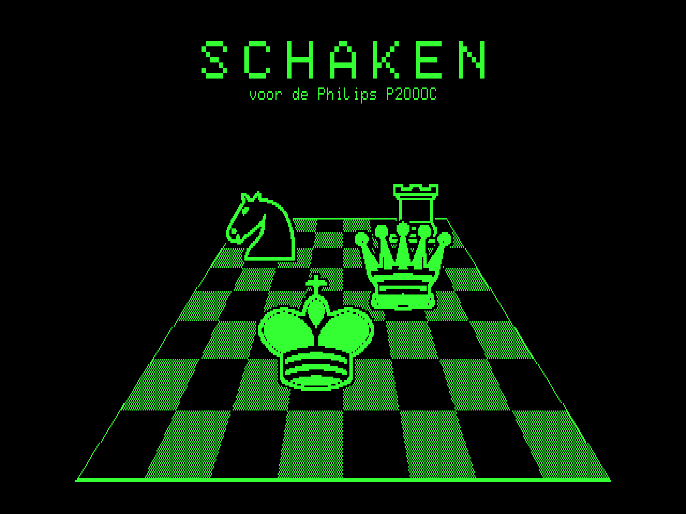
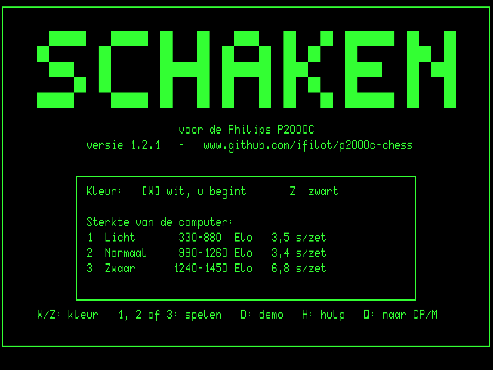
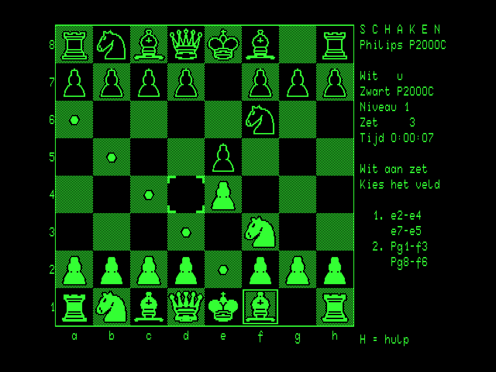
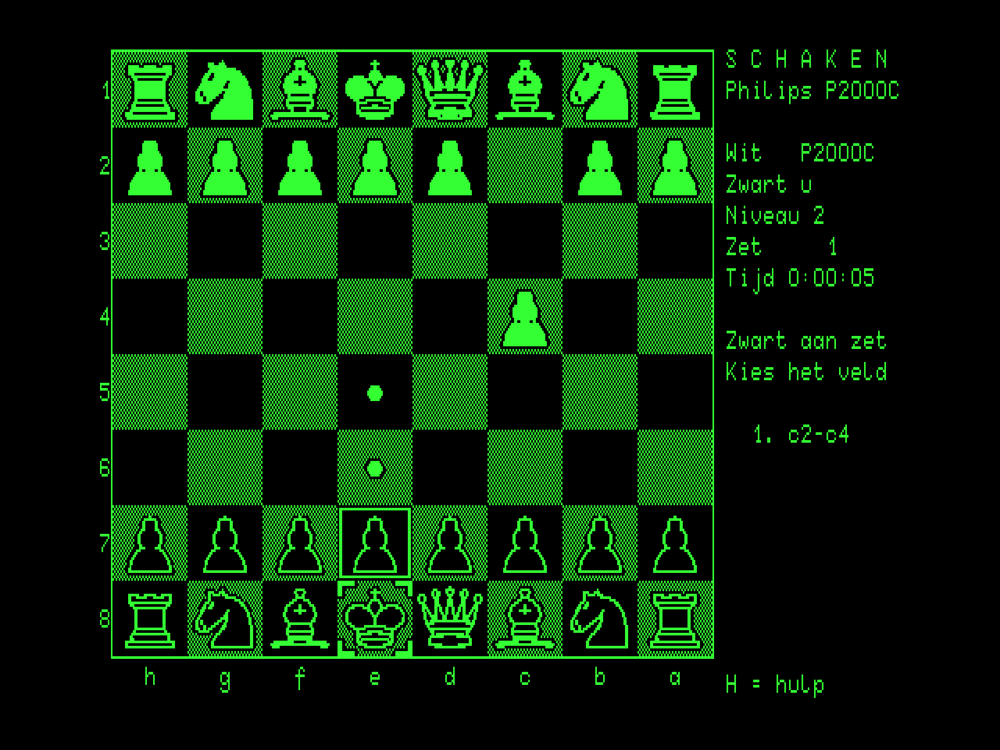
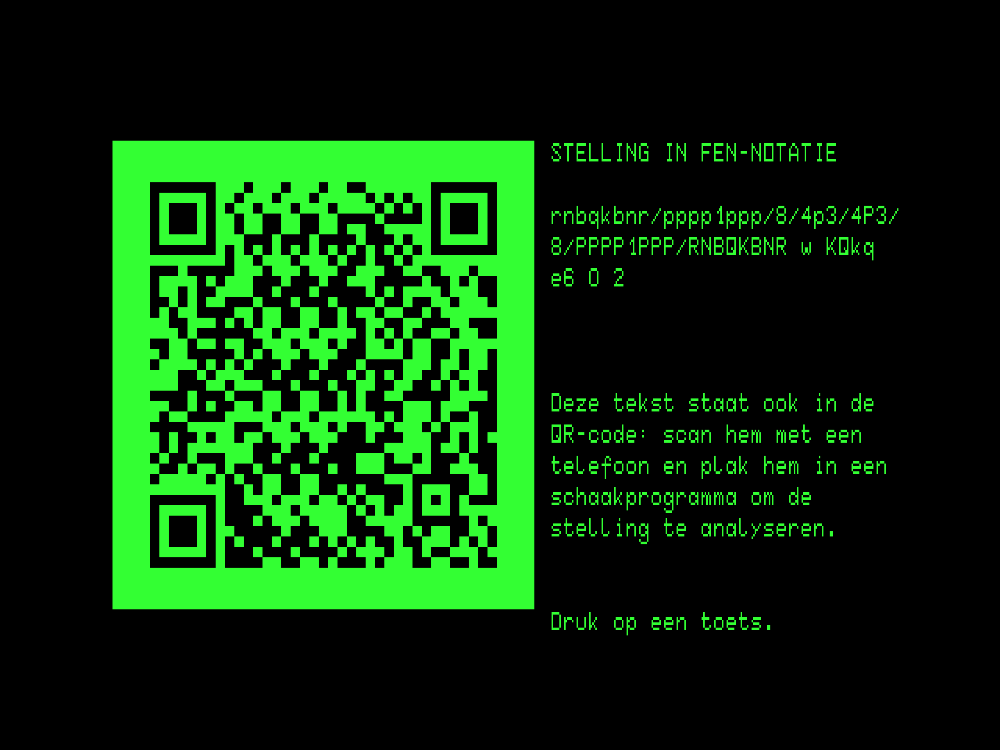

# Schaken (chess) for the Philips P2000C

[](https://github.com/ifilot/p2000c-chess/actions/workflows/build.yml)
[](https://github.com/ifilot/p2000c-chess/releases)
[](LICENSE)

Chess against the computer for the Philips P2000C running CP/M. The board
is drawn in the terminal board's 512x252 high-resolution graphics mode, and
the text plane carries the panel with the clock and the last moves. The
user interface is in Dutch. You choose your colour and one of three levels
at the start.

> [!NOTE]
> **More P2000C games:** Check out [Battleship](https://github.com/ifilot/p2000c-battleship),
> [Minesweeper](https://github.com/ifilot/p2000c-minesweeper),
> [Othello](https://github.com/ifilot/p2000c-othello), and
> [Tetris](https://github.com/ifilot/p2000c-tetris). For an all-in-one setup
> containing all five games, see the [P2000C ZuluBlaster SASI drive distribution](https://github.com/ifilot/p2000c-zulublaster-sasi-drive).

<p align="center">
  
  
</p>
<p align="center">
  
  
</p>
<p align="center">
  
</p>

## Play

Download `SCHAKEN.COM` and `SCHAKEN.GFX` from the [releases](https://github.com/ifilot/p2000c-chess/releases)
(or the latest [build artifact](https://github.com/ifilot/p2000c-chess/actions)), copy both
to the same CP/M disk and run `SCHAKEN`. `SCHAKEN.GFX` holds the piece
drawings and the title picture; the program looks for it on the current
drive and on every drive already in use, so `F:SCHAKEN` from `A>` works too.
With a ZuluBlaster/SASI setup, `make deploy` produces `build/HD1_256.hda`, a
second-disk image in the standard split layout with the game on F:. Copy it
to the SD card in place of the distribution's `HD1_256.hda` and run
`F:SCHAKEN`.

The start screen (plain text, so it appears instantly) asks for your
colour, `W` (White, you begin) or `Z` (Black; the board is turned so your
pieces are at the bottom), and `1`, `2` or `3` starts the game at that
level.

Moving is done with a cursor on the board. As soon as the cursor rests on
one of your pieces, the squares it can go to are marked: a dot on an empty
square, corner wedges on a piece it can capture. RETURN picks the piece up
(a frame appears round it); RETURN on a marked square plays the move. Only
legal moves are ever marked, so castling is simply moving the king two
squares (the rook follows), and en passant the pawn's diagonal step. A pawn
reaching the last rank asks for the piece: `D`ame, `T`oren, `L`oper or
`P`aard (RETURN takes the queen).

| Key | Action |
| --- | --- |
| Cursor keys or `W` `A` `S` `D` | Move the cursor |
| `RETURN` or space | Pick up the piece under the cursor; play it to a marked square |
| `RETURN` on the piece again, or `ESC` | Put it down |
| `T`, `BS` or `DEL` | Take back your last move and the computer's reply |
| `F` | The position as FEN text and QR code (see below) |
| `H` | Help screen with the rules (plain text mode) |
| `D` (start screen) | Demo: the computer plays itself (level 2 against level 3); any key stops it |
| `N` | Back to the start screen for a new game |
| `Q` | Quit, after confirmation (immediate on the start screen) |

The full rules apply: castling, en passant, promotion to any piece, check,
checkmate and stalemate, and draws by the fifty-move rule, by threefold
repetition and when neither side can mate. The panel shows the move number,
the elapsed time, the status (whose turn it is, check, the result) and the
last four moves of each side in long notation with the Dutch piece letters
(`Pg1-f3`, `e4xd5`, `O-O`, `e7-e8D`, `+` check, `#` mate). After five
minutes without a keypress a screen saver blanks the picture; any key
brings it back.

The terminal board finds keys through the video refresh, and while it is
busy with picture data it can take a key that is still held down for a
second press, most of all in graphics mode. Such a copy comes while the
finger is still on the key, so the program ignores the same key when it
arrives within a third of a second of the previous one. A key held down
longer repeats about three times a second. Built with
`make build EXTRA=-DKEY_TRACE`, the note row in the panel shows every key
as it comes in: its code in hex, the 60 Hz ticks since the previous key,
and a `-` when it was ignored.

### Position as FEN and QR code

`F` shows the current position in [Forsyth-Edwards Notation](https://en.wikipedia.org/wiki/Forsyth%E2%80%93Edwards_Notation)
(FEN), the standard one-line description of a chess position that every
chess program and site can import, next to a QR code. The QR code is a link
to the [Schaken web page](https://ifilot.github.io/p2000c-chess/) with the
position in the address (`https://ifilot.github.io/p2000c-chess/#` and the
FEN with `_` for its spaces). Scan it with a phone and the page draws the
board as the game does, dot for dot with the same bitmaps, green on black.
It shows the FEN to copy, links to an analysis board on lichess.org and can
turn the board; it is in Dutch and English. The code is a version-6 QR code
(41x41 modules) with modules of 6 dots by 4 lines, square on the CRT, dark
on a lit background as on paper. Drawing it takes about two seconds; any
key returns to the board (redrawn in about three and a half).

### Levels

All levels open from a small book of main lines, and choose at random among
moves of (nearly) equal value, so games vary.

| Level | Search | Example time per move (4 MHz, after 1.a3) |
| --- | --- | --- |
| 1 *licht* | one move ahead plus exchanges, picks among moves within 0.4 pawn of the best | 0.5 s |
| 2 *normaal* | two moves ahead plus exchanges | 1.4 s |
| 3 *zwaar* | deepens while time permits | 7.2 s |

Tactical positions take longer. Search time budgets are 10 seconds at
level 1, 5 seconds at level 2 and about 9.3 seconds at level 3. The clock
is checked in batches of nodes, so these budgets can be exceeded.

A fresh 140-game test on 2026-10-10, using the endgame pawn evaluation on
the emulated 4 MHz Z80, gave the following approximate strength estimates
(rounded):

| Level | Previous estimate | New estimate | Approximate 95% statistical interval |
| --- | --- | --- | --- |
| 1 | 730 | 660 | 330–880 |
| 2 | 1020 | 1130 | 990–1260 |
| 3 | 1310 | 1340 | 1240–1450 |

The difficulty-selection and help screens show the estimated Elo ranges
and average thinking times per move.

The test used 80 games against Stockfish 16 at its 1320 and 1520 settings
(100,000 nodes per move), plus 60 games between the app's levels, with both
colours represented equally. These estimates are relative to Stockfish's
configured Elo scale, not established human ratings. The intervals exclude
calibration and model error; see the testing commands below. The engine's
average thinking times against Stockfish were 3.5, 3.4 and 6.8 seconds at
levels 1–3, excluding display updates; the longest was 12.7 seconds.

Level 3 scored 20/40 (16 wins, 8 draws, 16 losses) in separate games against
the previous engine at the same BIOS time budgets. The confidence ranges
overlap the previous estimates: this test does not establish an overall
strength gain. Level 1 lost all 20 Stockfish games; its finite estimate
depends on games against the stronger app levels and is particularly
uncertain. A PVS/history/futility-pruning prototype scored 19/40 against
the previous engine and was discarded. See [the evaluation summary](docs/engine-evaluation.json).

The engine is an alpha-beta search with iterative deepening, a capture
search at the leaves, check extensions, killer moves and most-valuable-
victim ordering; the evaluation is material, piece-square tables, king
safety or centralisation depending on the phase, passed-pawn bonuses and
penalties for doubled and isolated pawn files in endgames, and a mop-up
term when the opponent has no pawns. Pawn-file masks update incrementally
and the extra evaluation runs in Z80 assembly. Repeated positions count
as draws inside the search.

## Build

The program is C (Z88DK/sdcc) with the display driver and the hot paths of
the rules (move generation, the attack test, making and taking back moves)
in Z80 assembly. It is compiled with the `z88dk/z88dk` Docker image:

```sh
make build            # -> build/SCHAKEN.COM and build/SCHAKEN.GFX
```

The rules and the engine are also plain C that compiles natively, which the
first two checks use (gcc); the other targets use the sibling
[P2000C ZuluBlaster SASI drive distribution](https://github.com/ifilot/p2000c-zulublaster-sasi-drive)
(headless emulator, CP/M disk images) and
[p2000c-emulator](https://github.com/ifilot/p2000c-emulator) (graphical
emulator, character-ROM font):

```sh
make perft              # move generator against the published perft counts (native)
make selfplay           # engine games on the host
make searchtest         # stalemate, mate and quiet check evasions at search leaves
make zsearchtest        # the same terminal-leaf checks with the Z80 assembly rules
make qrtest             # FEN of random games against the rules model, QR codes through a decoder
make site               # the web page the QR code opens -> build/site/ (serve it: python3 -m http.server -d build/site)
make zperft             # perft on the Z80 with rules.asm, in the headless emulator
make test               # games against the computer in the headless emulator
make run                # open the game in the graphical emulator (WSLg/Linux)
make screenshot         # plain raster dump (green on black) -> build/board.png
make deploy             # build/HD1_256.hda: second SASI disk with the game on F:
make sprites            # regenerate the two parts of SCHAKEN.GFX (needs rsvg-convert)
python3 tools/bench.py  # emulated thinking time per level
python3 tools/match_stockfish.py --games 2  # native matches against local Stockfish
```

In native mode, the Stockfish runner needs only Python, gcc and a local Stockfish executable
(`--stockfish PATH` overrides its location). It plays both colours at each
level against unrestricted Stockfish, skill 0, and the UCI 1320 strength
setting, then tests three basic winning endgames. Every legal move set and
resulting FEN is checked against the separate Python rules model. Results,
coordinate moves and search statistics are saved to
`build/stockfish-results.json`. These matches use the native engine's node
budgets, not the Z80 clock or assembly rules; use `tools/bench.py` to measure
emulated thinking time. The small match sample and Stockfish's strength
settings should not be interpreted as a measured Elo rating.

For a larger strength estimate, run:

```sh
python3 tools/match_stockfish.py --games 20 --elos 1320 1520 1720 --nodes 100000 --no-endgames --out build/ratings.json
```

`--games` counts games per colour, level and opponent. The JSON includes
an Elo performance estimate fitted to the game scores, with approximate
95% statistical intervals. Zero wins/draws produce an upper bound instead
of a finite rating. These numbers are relative to Stockfish's configured
Elo opponents under the chosen node limits, not FIDE, chess.com or lichess
ratings. Stockfish 16 only supports Elo settings from 1320 to 3190;
estimates below 1320 extrapolate from results against its weakest setting.
Its [strength calibration](https://github.com/official-stockfish/Stockfish/blob/sf_16/src/search.cpp#L85)
uses a different time control (60 seconds plus 0.6 seconds per move) and
the CCRL engine rating scale. Native search budgets also approximate the
P2000C's clock-based search; the intervals do not include those systematic
differences. Completed games are saved after each match.

For estimates using the actual 4 MHz Z80 engine and its BIOS time budgets,
build the persistent engine-only emulator bridge (requires the sibling
disk-tool checkout with its native emulator already built):

```sh
make zmatch
python3 tools/match_stockfish.py --z80 --games 10 --elos 1320 1520 --nodes 100000 --no-endgames --out build/z80-anchors.json
python3 tools/rate_chess.py --z80 --input build/z80-anchors.json --games 10 --out build/z80-ratings.json
```

The second command plays Stockfish matches with both colours. The third
adds games between all three app levels, so a weak level can be rated
through stronger levels even if it loses every game to Stockfish. Both
runners check every legal move set and resulting FEN against the separate
Python rules model. The Z80 mailbox uses the same engine optimisation
flags and assembly rules as the game, the real emulated 60 Hz BIOS timer,
and temporary copies of the disks; the graphics interface is omitted.
Stockfish still uses the requested node limit, so these remain approximate
performance estimates on its configured Elo scale. The app's 300-ply
maximum game length is counted as a draw. Native and Z80 results cannot
be combined in one rating fit.

To compare revisions directly, save `ZMATCH.COM` and `zmatch.map` in a
separate directory before rebuilding the engine, then run:

```sh
python3 tools/compare_engines.py --baseline build/baseline-1.2.1 --levels 3 --games 20 --seed 40000
```

This plays 40 games with both colours at the same level and BIOS time
budget. `--engine-dir` selects a saved binary for the Stockfish and rating
runners; `--seed` selects fresh game seeds. New rating files carry binary
fingerprints, and the fitter rejects data from a different binary.

`make test` plays with the cursor keys like a player would, reads the
computer's moves from the panel and checks every one, the move list and the
result against a separate rules model (`tools/chessmodel.py`); it also opens
the FEN page and checks the text and, read back from the emulated screen,
the QR code. The QR checks need the `zxing-cpp` Python module
(`pip install zxing-cpp`); without it they are skipped.

## Layout

| File | Contents |
| --- | --- |
| `src/main.c` | Program flow: data file, title picture, start screen, games |
| `src/game.c`, `src/game.h` | Game state, the cursor interface, turns, take-backs, the demo |
| `src/screen.c`, `src/screen.h` | Board picture: composing squares in the framebuffer and uploading what changed |
| `src/panel.c`, `src/panel.h` | Status panel and move list on the text plane |
| `src/screens.c`, `src/screens.h` | Start and help screens (text mode), title picture, FEN page |
| `src/chess.c`, `src/chess.h` | Rules: 0x88 board, incremental score and Zobrist key, repetitions, draws (C versions of the assembly for the native tools) |
| `src/rules.asm` | Move generation, the attack test, making and taking back moves |
| `src/cpu.c`, `src/cpu.h` | Computer player: search, evaluation, opening book |
| `src/qr.c`, `src/qr.h` | QR code encoder (version 6-L, byte mode) for the FEN page, and the web page's address |
| `src/gfx.c`, `src/gfx.h` | Loads `SCHAKEN.GFX` via the BDOS |
| `src/memory.asm` | The big buffers (board, framebuffer, search stacks, bitmaps), placed past the program |
| `src/clock.c`, `src/saver.c` | Game clock from the BIOS 60 Hz timer; screen saver |
| `src/video.asm`, `src/video.h` | Framebuffer primitives, `ESC r` row uploads, BIOS and BDOS calls |
| `src/sprites.bin`, `src/sprites.h` | Generated bitmaps (first part of `SCHAKEN.GFX`) and their offsets |
| `src/splash.rle`, `src/splash.h` | Generated run-length title picture (second part of `SCHAKEN.GFX`) |
| `site/` | The web page the QR code opens: FEN reader, the board composed as in `screen.c`, the page |
| `tools/` | Generators, emulator launchers, screenshot, tests, perft, self-play, benchmark |
| `tools/pieces/` | The piece drawings (SVG) |

## License

GNU General Public License v3.0; see [LICENSE](LICENSE). The piece drawings
in `tools/pieces/` are by Colin M.L. Burnett (Wikimedia Commons, GFDL/BSD/GPL),
used under the GPL. The character-ROM font sheet used by the tooling belongs
to the [p2000c-emulator](https://github.com/ifilot/p2000c-emulator) project.

## Browser website

[Play Chess in your browser](https://ifilot.github.io/p2000c-chess/). The original
CP/M game boots automatically in the WebAssembly P2000C emulator. The page uses
the ZuluBlaster green-screen style with Dutch/English instructions.

For real hardware, [download the all-in-one ZuluBlaster SD-card image](https://github.com/ifilot/p2000c-zulublaster-sasi-drive/releases/latest):
all six maintained games, CP/M, applications and development tools. You can
also [try the complete Navigator bundle in your browser](https://ifilot.github.io/p2000c-zulublaster-sasi-drive/).

Every push to `master` builds the game, compiles WebAssembly, checks that the
boot image opens this game, and deploys `_site/` with GitHub Actions Pages.
Pull requests build and validate without deploying. Pages must use **GitHub
Actions** as its publishing source, with `master` allowed in `github-pages`.

To build locally, use a ZuluBlaster checkout at `fea018441580b3ba17d5f54f493b639f515e189d`:

```sh
make build
make -C ../p2000c-zulublaster-sasi-drive emulator-web
python3 tools/build_site.py --toolchain ../p2000c-zulublaster-sasi-drive
python3 -m http.server 8000 --directory _site
```

The shared emulator, disk builder, IPL and original font come from that pinned
ZuluBlaster checkout. Copied web code retains GPL notices; the built site
includes game/emulator licenses and `provenance.json`. Browser disk writes
last for the current page session; reloading starts from the published image.
